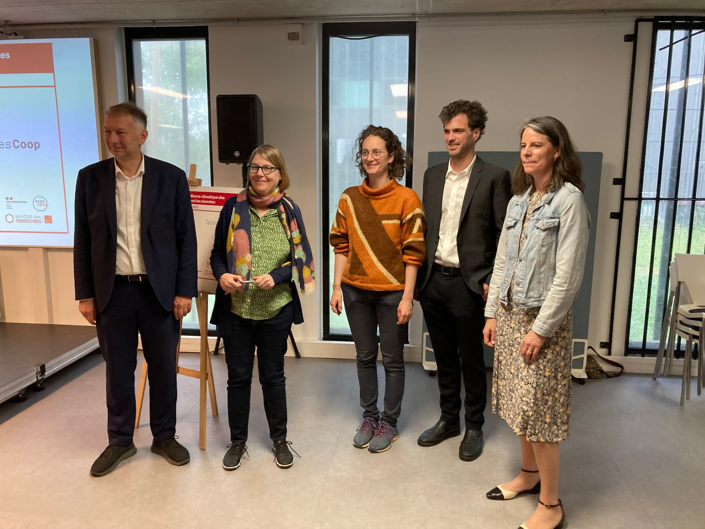

IA·rbre a pris racine... officiellement !
Après des mois de travail en coulisses, le projet **IA·rbre** a été lancé publiquement en novembre 2024. Il était grand temps de le célébrer avec vous ! 🎉

La matinée a débuté par un temps presse riche en découvertes !   
🗺️ Une déambulation immersive avec plusieurs temps forts :

- Retour sur la genèse du projet, illustrée par la maquette augmentée et le calque V1 réalisé par [**Exo-Dev**](https://exo-dev.fr/)
- Présentation des premières avancées de la [plateforme **IA·rbre**](https://carte.iarbre.fr) 🌿
- Démonstration du **calculateur d’[itinéraires fraîcheur & pollen](https://cartes.lyon.fr/lieux-et-parcours-frais/)** de la Métropole 🌬️🌸

🎤 Trois figures institutionnelles nous ont ensuite honoré de leurs prises de parole :

- **Agnès Sindou-Faurie**, Directrice régionale adjointe de la Banque des Territoires
- **Isabelle von Bueltzingsloewen**, Présidente de l’Université Lumière Lyon 2
- **Bruno Bernard**, Président de la Métropole de Lyon

✍️ Un moment symbolique a suivi : la signature de la convention par **Camile Legeron** (co-gérante de **TelesCoop**) aux côtés de Bruno Bernard et Isabelle von Bueltzingsloewen.

☕ La matinée s'est conclue autour d’un temps convivial et d'échanges avec les médias présents.  
Et bonne nouvelle : les **premières retombées presse** sont déjà là !  
📰 [BFMTV Lyon](https://www.bfmtv.com/lyon/la-metropole-de-lyon-veut-recourir-a-l-ia-pour-planter-des-arbres_AV-202505230500.html)  
📰 [Le Progrès](https://www.leprogres.fr/economie/2025/05/24/quand-l-ia-sert-a-(mieux)-planter-des-arbres)  
📰 [Lyon Mag](https://www.lyonmag.com/article/144246/la-metropole-de-lyon-veut-faire-appel-a-l-intelligence-artificielle-pour-planter-des-arbres)  
📰 [Banque des Territoires ](https://www.banquedesterritoires.fr/lancement-du-projet-iarbre)  
📰 [Lyon ](https://www.lyoncapitale.fr/environnement/planter-des-arbres-avec-l-intelligence-artificielle-le-pari-de-la-metropole)[Capitale](https://www.lyoncapitale.fr/environnement/planter-des-arbres-avec-l-intelligence-artificielle-le-pari-de-la-metropole)  
📰 [Lyon ](https://www.lyoncapitale.fr/environnement/planter-des-arbres-avec-l-intelligence-artificielle-le-pari-de-la-metropole)[Capitale](https://www.lyoncapitale.fr/environnement/planter-des-arbres-avec-l-intelligence-artificielle-le-pari-de-la-metropole)  
📰 [Lyon Entreprise](https://www.lyon-entreprises.com/actualites/article/la-metropole-de-lyon-lance-ia-rbre-une-ia-frugale-pour-piloter-la-transition-ecologique-des-territoires)  
📰 [AEFinfo](https://www.aefinfo.fr/depeche/731716-developpe-a-lyon-le-projet-iarbre-doit-faciliter-les-politiques-de-vegetalisation-du-territoire)  

Vous pouvez aussi retrouver toutes les infos dans le [communiqué de presse](https://CP_22mai.pdf).

✨ **Une belle réussite selon tous·tes** et ce n'est que le début ! Hâte de vous dévoiler la suite du projet IA·rbre !
Vous pouvez d'ailleurs vous [abonner à notre newsletter ](https://app.keila.io/forms/nfrm_6b3DZDVg)!
