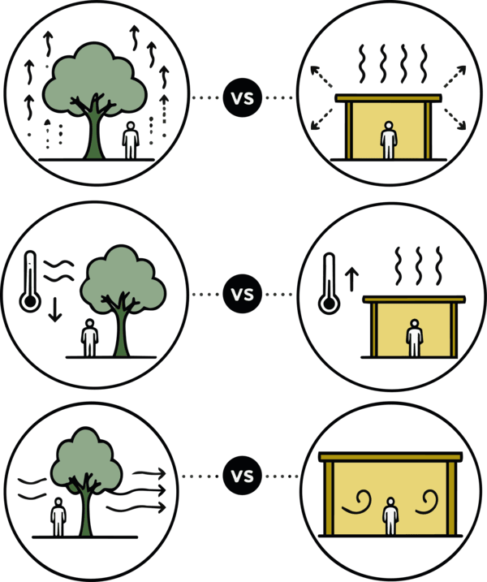

C'est lié à **l'évapotranspiration** de l'arbre ! Pour permettre une bonne circulation de la sève, un arbre a besoin d'évaporer une très grande quantité d'eau (en moyenne son poids en eau chaque jour !). Autant d'eau à évaporer dans l'atmosphère permet de baisser la température localement. Une tôle, quant à elle, ne transpire pas. Et en plus, elle accumule de la chaleur, monte en température et donc continue à rayonner de la chaleur, même en pleine nuit.

Le **confort thermique** se fait en partie sur la **température ambiante**, mais aussi beaucoup sur le **rayonnement ambiant** et les et **les circulations d'air**.

La circulation de l'air est encore un bon point pour l'arbre. L'arbre, avec un tronc fin et une couronne large au-dessus, va moins bloquer les circulations d'air au niveau des personnes qu'un préau qui aura besoin de murs pleins pour tenir debout.

Cependant, cet argument se renverse dans le cas d'une forêt, où les troncs vont finir par bloquer le courant d'air, et en comparaison d'une ombrière textile qui repose juste sur des poteaux !

